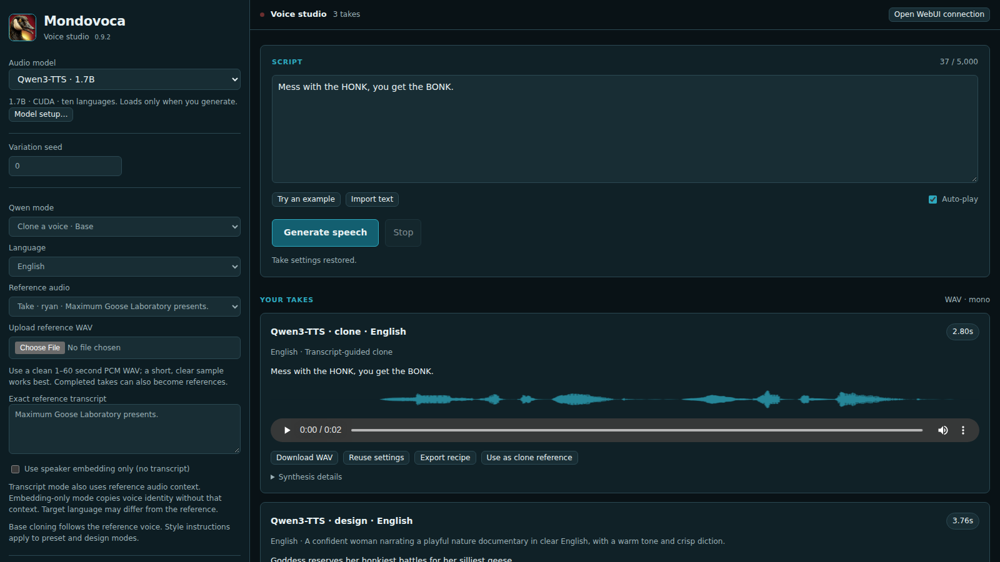

# Mondovoca 0.9.2

One studio for writing scripts and voicing them with the speech models on your own computer. The same script box, voice controls and take history work with every engine, so a voice found with one model can read the next script, on that model or another.



A voice takes shape over a run of takes: a description reworded, a delivery cue added, a seed changed, the same lines tried on another engine. Each take keeps its script and settings beside its audio, so any of them can be played back, picked up again as it was, or become the voice for something new.

Generate runs the engine you picked on this computer, with the script and settings on screen.

## Working in Mondovoca

- Describe a voice in plain words — *a warm, low adult voice speaking slowly with quiet excitement* — and press **Generate speech**. The take appears at the top of **Your takes** with its waveform, script and settings.
- Press **Use as clone reference** on a take and it becomes the reference audio for the selected engine, its script filled in as the transcript where the engine uses one. Type a new script and that voice reads it.
- Press **Reuse settings** on a take and its script and every setting return to the studio. Change one thing and generate again.
- Choose another engine under **Audio model** and the sidebar shows that engine's own controls, with the script still in place. **Save voice** keeps the current engine and settings under a name, listed under **Saved voices** in this browser.
- Open **Open WebUI connection** for the address, model ID and parameters that let Open WebUI speak its chats with the voice set up here.

## Run locally

Mondovoca needs Python 3.10 or newer and nothing beyond its standard library. From the checkout:

```bash
./start.sh
# Open http://127.0.0.1:8093
./stop.sh
```

The studio opens with no engines installed. Install each engine you want in its own Python environment, following its own instructions; the [engine guide](docs/engines.md) gives each one's files and layout. Then open **Model setup…** under **Audio model**, enter the engine's Python and model folder, save, and choose the engine. Write a script and press **Generate speech**.

Finished takes download to your browser's download folder. **Save location…** under *Saved takes* switches to saving each take in a folder on this computer instead, where the latest 100 are listed again whenever the studio starts. [Setup and saved takes](docs/setup.md) covers the port, environment overrides and both save modes.

## Speech engines

| Engine | Runs on | Voices | Languages |
| --- | --- | --- | --- |
| Tiny Voca | CPU | Two fixed voices, F2 and M2, with age, speed and pitch styling and a side-by-side **Compare both voices** | English |
| Qwen3-TTS 1.7B | CUDA | Nine preset speakers directed in words, new voices from a description, and cloning from a 1–60 second reference | Ten languages, or automatic detection |
| AuK Base | CUDA | Voices from a description, and cloning from a reference without a transcript; a target duration of up to 120 seconds per take | English by default; other languages named in the description |
| Fish Audio Drama 3 INT8 | CUDA, with experts in system RAM | The model picks a voice from the script and inline cues such as `[whispers]` and `[laughs]`; cloning from a reference and its transcript | The language the script is written in |
| Robin | CUDA | Voices from a description, a reference recording or a voice LoRA at an adjustable strength; `[laughs]` and `[coughs]` inline | English, Japanese, or both mixed |

Tiny Voca and Qwen3-TTS write 24 kHz mono WAV, Robin 48 kHz mono. Tiny Voca cannot clone, so **Use as clone reference** on a Tiny Voca take switches the studio to Qwen3-TTS cloning. Each take loads its engine in a separate process and releases it when the take ends; choosing an engine or saving Model setup loads nothing. Upstream measured about 17 GiB of VRAM for AuK with CPU offload on short examples, and about 21.5 GiB of VRAM plus roughly 48 GB of system RAM for Fish with its default 16 GiB expert cache. Engine licences can restrict how the speech they generate is used; the [licence table](#licence) lists them. The [engine guide](docs/engines.md) has every control, sampling range and API parameter.

## Scope

Mondovoca is a studio for one computer: it listens only on the loopback address, with no accounts, remote access or TLS. It installs no engines, ships no model weights and downloads nothing; engines live outside this repository, where other programs can share them. Voice LoRA training, AuK speech editing and Fish's director revisions stay in each engine's own tools.

## Further reading

- [Setup and saved takes](docs/setup.md): start and stop scripts, the port, environment overrides, model settings, save locations and cancellation.
- [Speech engines](docs/engines.md): installation, file layouts, controls, sampling and API parameters for each engine.
- [API and Open WebUI](docs/api.md): the OpenAI-compatible speech endpoint, job endpoints and the Open WebUI settings.
- [Development](docs/development.md): tests, browser checks and how versions are numbered.
- [NOTICE.md](NOTICE.md): which files carry third-party material, where each came from, and which agent made which integration.
- [CHANGELOG.md](CHANGELOG.md): what each version changed.
- The engines, each installed separately: [Tiny Voca](https://github.com/n4ze3m/tiny-voca), [Qwen3-TTS](https://github.com/QwenLM/Qwen3-TTS), [AuK](https://github.com/Tencent-Hunyuan/AuK), [ComfyUI-Drama3](https://github.com/PedroMarinhoDev/ComfyUI-Drama3) and [Robin](https://github.com/Fixed-Seed/Robin).

## Author and contributors

1. **[hodgemann](https://github.com/hodgemann)** — creator and project lead.
2. **Codex (OpenAI)** — initial Mondovoca implementation, and the Qwen3-TTS, AuK
   and Fish Audio integrations.
3. **Qwen Code (Alibaba)** — the output-folder history refresh, the folder-to-browser spool
   fix, the Robin backend and studio UI, and the Mondocraft theme re-sync, each
   reviewed and verified by Codex; read-only review of the Qwen3-TTS API.
4. **Strata Scribe (Qwen Code)** — the first release-prep README pass and the
   attribution notices.
5. **Claude (Anthropic)** — the README rewrite and the documentation pages under
   `docs/`.

## Licence

Mondovoca is licensed under the [Apache License, Version 2.0](https://www.apache.org/licenses/LICENSE-2.0),
reproduced in [LICENSE](LICENSE). [NOTICE.md](NOTICE.md) records the provenance of
`src/mondovoca/static/tooltips.js` and `src/mondovoca/static/themes.css`, copied
from [Mondocraft](https://github.com/hodgemann/Mondocraft) — Apache-2.0 as
well — with their original comments intact.

No engine source, model weights or Python environments are bundled or
redistributed. Each engine is installed separately and keeps its own terms, which
apply to the copy you install:

| Engine | Licence |
| --- | --- |
| Tiny Voca | Apache-2.0; its weights Apache-2.0, its training dataset CC BY 4.0 |
| Qwen3-TTS | Apache-2.0 |
| AuK | MIT; the required Qwen2.5-Omni-3B encoder is under the Qwen Research License — noncommercial research and evaluation, commercial use needs separate permission |
| Fish Audio Drama 3 INT8 | Fish Audio Community License for the weights and derived runtime components; the separately installed ComfyUI libraries are GPL-3.0 |
| Robin | Fixed Seed Open License v1.0, Apache-2.0 with a commercial-use revenue threshold; its `speech_tokenizer_v3_25hz.onnx` comes from CosyVoice 3 under Apache-2.0 |

Those terms reach past the engine files: they can restrict how speech generated
with that engine may be used or redistributed, so check them before publishing
takes made with a noncommercial or revenue-thresholded engine. Built with Qwen,
Fish Audio and Robin, as their notices require.
